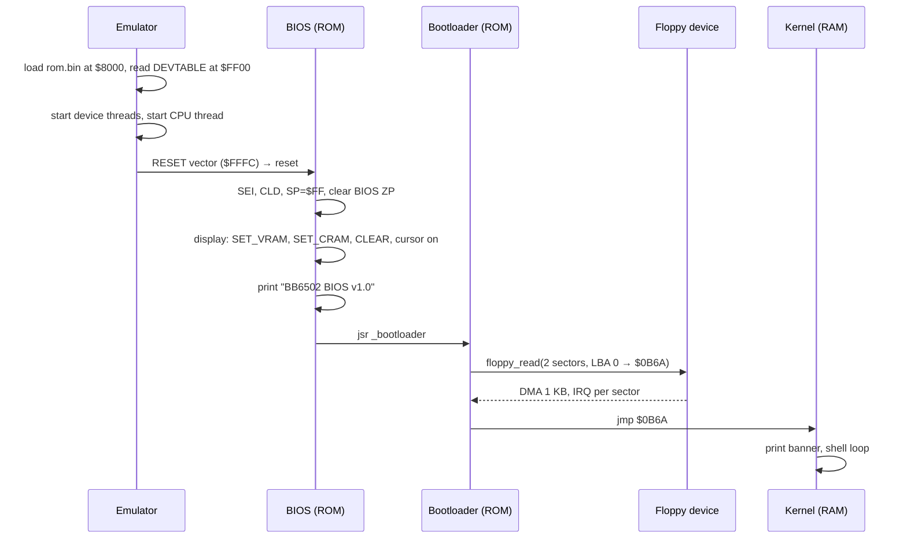

# Architecture

This page gives the big picture: what runs where, in what order, and where it sits in memory. For register-level detail, see [hardware-interface.md](hardware-interface.md).

## Layers

```
┌──────────────────────────────────────────────┐
│ Kernel (RAM, loaded from floppy)             │  bb6502_emu_dbg/software/src/boot/kernel.s
│   command shell                              │
├──────────────────────────────────────────────┤
│ BIOS + bootloader (ROM $8000-$FFFF)          │  software/src/utils/bios.s, boot/bootloader.s
│   console I/O, display, keyboard, floppy,    │
│   IRQ handler, device table, vectors         │
├──────────────────────────────────────────────┤
│ "Hardware" = emulator (C)                    │  bb6502_emu_dbg/emu/
│   6502 CPU thread + one thread per device    │
└──────────────────────────────────────────────┘
```

The OS never hardcodes knowledge of the emulator, and the emulator never hardcodes where devices live. The ROM publishes a **device table** at `$FF00` that lists each register's address, and the emulator reads it at startup. That table is the only contract between the two. It is also what will make moving to real hardware possible later.

## Boot sequence



If the floppy read fails, the bootloader prints an error and returns. The BIOS then prints "No kernel found" and halts.

## Memory map

The address space is 64 KB: **32 KB RAM** (`$0000-$7FFF`) and **32 KB ROM** (`$8000-$FFFF`). Everything is defined in [`software/src/utils/vars.s`](../bb6502_emu_dbg/software/src/utils/vars.s).

| Range | Size | Contents |
|---|---|---|
| `$0000-$000F` | 16 B | BIOS zero page: STRPTR, CMPPTR, JMPPTR, KBD_LAST, FLOPPY_DONE, display state |
| `$0010-$00FF` | 240 B | Free zero page (no ownership rules yet) |
| `$0100-$01FF` | 256 B | 6502 hardware stack |
| `$0200-$0209` | 10 B | Memory-mapped device registers |
| `$020A-$06B9` | 1200 B | VRAM: 40×30 characters |
| `$06BA-$0B69` | 1200 B | CRAM: 40×30 colour attributes |
| `$0B6A-$0F69` | 1 KB | Kernel image (2 floppy sectors) |
| `$0F6A-$1069` | 256 B | Kernel BSS (`kernel_ipbuf`, the shell's line buffer) |
| `$106A-$7FFF` | ~28.5 KB | **Free RAM**, intended for user programs |
| `$8000-$FEFF` | ~32 KB | ROM: bootloader + BIOS (about 1 KB used) |
| `$FF00-$FF0F` | 16 B | Device table (8 × 16-bit pointers) |
| `$FFFA-$FFFF` | 6 B | NMI / RESET / IRQ vectors |

Things to know:

- In the emulator, "ROM" is ordinary memory. Nothing stops a program from writing to it.
- The display has no memory of its own. It renders VRAM/CRAM from main RAM every frame, so the BIOS (or any program) draws by writing bytes into RAM.
- This map deliberately differs from Ben Eater's (VIA at `$6000`, ACIA at `$5000`). It is laid out to maximize contiguous free RAM. Real hardware would need address decoding for the `$02xx` I/O page.

## Interrupts

There is one IRQ line, shared by all devices. A device thread sets a flag, and the CPU thread takes the interrupt before its next instruction if the `I` flag is clear. The BIOS IRQ handler polls every device to find the source:

- **Keyboard.** The data register is nonzero. The handler copies the byte to `KBD_LAST` and acknowledges by writing 0.
- **Floppy.** `STATUS.IRQ` is set. The handler clears it and sets `FLOPPY_DONE`.

NMI is wired to a bare `rti`; nothing generates one.

## Source map

| Want to change... | Look in |
|---|---|
| Addresses, device register locations, colours | `software/src/utils/vars.s` |
| Console/display/keyboard/floppy routines, IRQ handler | `software/src/utils/bios.s` |
| What gets loaded at boot and where | `software/src/boot/bootloader.s`, `software/floppy.cfg` |
| Shell commands | `software/src/boot/kernel.s` |
| Device behaviour (timing, protocol) | `emu/src/include/<device>.c` |
| CPU core, MMIO routing, startup/shutdown | `emu/src/include/fake6502.c` |
