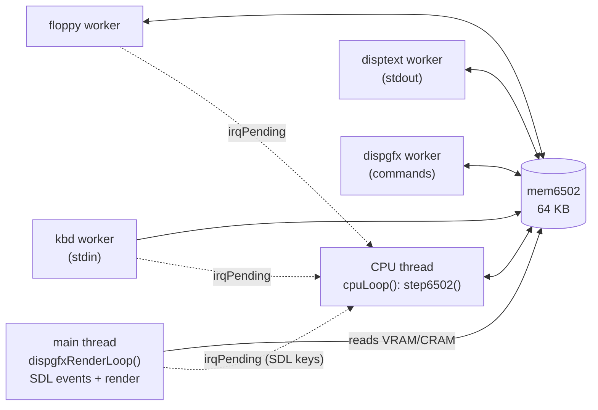

# Emulator internals

The emulator is in `bb6502_emu_dbg/emu/`. It is C11 with pthreads and SDL2.

## Files

| File | Role |
|---|---|
| `src/main.c` | Calls `fake6502Init()` |
| `src/include/fake6502.c/.h` | CPU core (Mike Chambers' Fake6502) plus machine glue: shared state, MMIO dispatch, CPU thread, startup/shutdown, argument parsing |
| `src/include/floppy.c/.h` | Floppy controller worker |
| `src/include/kbd.c/.h` | Terminal keyboard worker |
| `src/include/disptext.c/.h` | Text console worker |
| `src/include/dispgfx.c/.h` | Display command worker, SDL render loop, SDL key forwarding |

## Threads



- **macOS needs SDL on the main thread**, so `fake6502Init()` creates the window, starts the CPU thread, and then turns the main thread into `dispgfxRenderLoop()`.
- The CPU runs flat out with no clock throttling, so it uses a full host core.
- Device threads **never touch CPU registers**. To interrupt, they set `irqPending`, and `cpuLoop()` calls `irq6502()` before the next instruction when `I` is clear. A request made while `I` is set stays pending until the program executes `CLI`.

## Shared state (`fake6502.c`)

| Symbol | Meaning |
|---|---|
| `mem6502` | The whole 64 KB address space (RAM, registers and ROM) as one array |
| `running` | Atomic; cleared on ESC or window close to stop everything |
| `devicesReady` | Set once every device has read its register addresses; turns on MMIO dispatch |
| `irqPending` | Atomic; set by devices, consumed by the CPU thread |
| `<dev>Lock` / `<dev>Cond` | One mutex and one condition variable per device |

## MMIO dispatch

`read6502()`/`write6502()` check whether an address is one of a device's registers. Those addresses come from the device table. For a register access:

- Take that device's mutex, then read or write `mem6502[address]`.
- On a write of a nonzero command, also `pthread_cond_signal` the device's condition variable to wake its worker.

Every other address is plain array access. Two registers are not routed through a lock: the keyboard DATA register and the floppy DATA high byte. Today this is harmless, because of the order in which the BIOS writes them.

## Startup / shutdown (`fake6502Init`)

1. Parse arguments (`<binary> -f <floppy>`; `-d`/`-s`/`-u` are accepted and ignored).
2. Load the binary. A 64 KB file loads at `$0000`; anything smaller loads at `$8000`.
3. `kbdInit`, `floppyInit`, `disptextInit`, `dispgfxInit`. Each reads its addresses from the device table and starts its worker thread.
4. `devicesReady = 1`, then start the CPU thread (which executes `reset6502()`, then loops).
5. `dispgfxRenderLoop()` blocks until quit.
6. Clear `running`, wake every worker, join the CPU thread, and tear down SDL.

## Device worker pattern

Every command-driven worker looks like this:

```c
while (running) {
    pthread_mutex_lock(&devLock);
    while (mem6502[cmdReg] == CMD_NOP && running)
        pthread_cond_wait(&devCond, &devLock);
    pthread_mutex_unlock(&devLock);
    if (!running) break;

    status = BUSY;  /* do the work */  cmd = NOP;  status = IDLE;
    /* optionally: irqPending = 1; */
}
```

## Adding a new device

1. **ROM side.** Pick register addresses in `vars.s`, then add a `.word` entry to `DEVTABLE` in `bios.s`. Keep the table within `$FF00-$FFF9`, below the vectors.
2. **Emulator side.** Create `src/include/<dev>.c/.h` with `<dev>Init()` and a worker:
   - `<dev>Init()` reads its address from the table (`read6502(TABLE_ADDR) | read6502(TABLE_ADDR+1) << 8`) and starts the worker thread.
   - The worker follows the pattern above.
3. Add a `<dev>Lock`/`<dev>Cond` pair in `fake6502.c` and declare them `extern` in `fake6502.h`. Add the device's registers to `read6502()`/`write6502()`.
4. Call `<dev>Init()` in `fake6502Init()` before `devicesReady = 1`. Wake the worker in the teardown section.
5. If the device interrupts, set `irqPending = 1`, and extend the BIOS `irq` handler to poll the device's status.

The Makefile picks up new `.c` files automatically.

## CPU core caveats

- `fake6502` emulates an **NMOS 6502 with undocumented opcodes**, and BCD is disabled (`NES_CPU`). The software is assembled with `ca65 --cpu 65c02`, so 65C02-only instructions (`stz`, `phx`, `bra`, `(zp)` addressing …) would assemble without complaint but execute as the wrong instruction. Avoid them, or switch the assembler to `--cpu 6502`.
- "ROM" is writable.
- BRK goes through the IRQ vector, and the BIOS does not tell BRK and IRQ apart.
